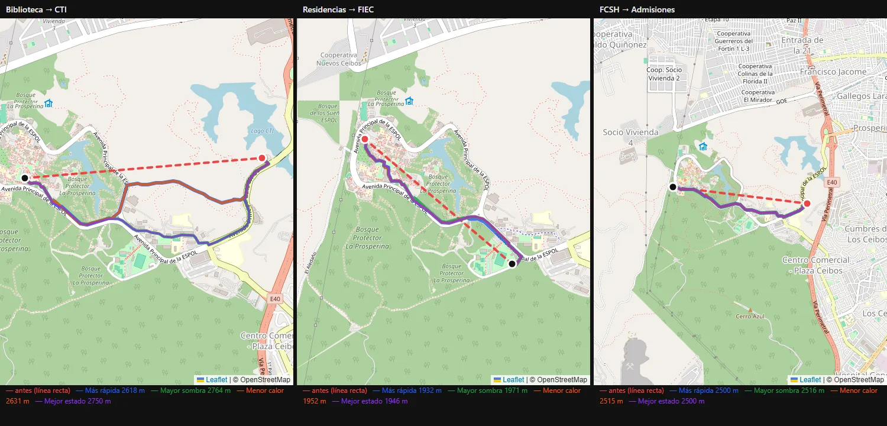

# Mi ESPOL+ (Campus ESPOL+)

Prototipo de alta resolución, convertido en app Android, que extiende la experiencia de **Mi ESPOL** con tres módulos de movilidad dentro del campus Gustavo Galindo de la ESPOL (Guayaquil, Ecuador). Está hecho con **Expo + React Native + TypeScript**.

[](https://github.com/SagazArias/MiEspol/actions/workflows/ci.yml)

> **Prototipo:** los reportes de obstáculos, los votos, los puntos y el ranking se guardan en el teléfono (AsyncStorage); todavía no hay un backend que los comparta entre usuarios.

## Problema

Para moverse a pie por un campus grande y caluroso no basta con la ruta más corta: importan la sombra, el calor, el estado de los senderos y los obstáculos temporales, como obras o charcos. La app junta esa información en un solo lugar y además premia la movilidad activa.

## Funcionalidades

### Módulos principales

| Módulo | Qué hace |
|---|---|
| **Ruta Inteligente según el clima** | Toma la posición GPS del usuario, pide el clima del campus a Open-Meteo (temperatura, humedad, viento, UV, probabilidad de lluvia) y calcula **4 rutas alternativas** hacia uno de los 14 destinos: *Más rápida*, *Mayor sombra*, *Menor calor* y *Mejor estado*. |
| **Alertas inteligentes de obstáculos** | Los usuarios reportan obstáculos con descripción, severidad y foto (cámara o galería). Una bandeja comunitaria muestra los reportes, y cada usuario puede votar si el obstáculo sigue ahí. Con **3 votos de "ya no está"** el reporte se elimina. Los obstáculos de severidad media o alta bloquean los tramos del grafo que estén a menos de 90 m. |
| **Navegación e incentivos** | Navegación a pie con seguimiento GPS (`watchPositionAsync`) y conteo de pasos con el podómetro (`expo-sensors`). Las caminatas validadas suman puntos, nivel (1 nivel cada 120 pts), rachas, misiones diarias y semanales, y posición en un ranking semanal. |
| **Ganadores y premios** | Top 3 semanal, tu posición, puntos acumulados y un catálogo de recompensas canjeables, con productos de ESPOL Shop (gorras, termos, cuadernos, bolsos…) y cupones del campus. |

### Pantallas (`src/screens/`)

| Pantalla | Descripción |
|---|---|
| `HomeScreen` | Panel inicial con tarjetas de módulos (Académico, Calendario, Bienestar, Certificados, Restaurantes, Mapa) y los tres módulos nuevos. |
| `RutaInteligenteScreen` | Selector de destino, resumen del clima con consejo (`weatherAdvice`), las opciones de ruta y el mapa. |
| `WalkNavigationScreen` | Navegación activa: sigue al usuario, recalcula la ruta desde el GPS y cuenta pasos. |
| `NavegacionIncentivosScreen` | Puntos, misiones, racha y progreso del usuario. |
| `GanadoresPremiosScreen` | Ranking semanal, recompensas y catálogo de ESPOL Shop. |
| `AlertasScreen` | Avisos administrativos y obstáculos reportados por la comunidad, con votación. |
| `ReportObstacleScreen` | Formulario de reporte con foto (`expo-image-picker`) y ubicación. |
| `CarnetScreen`, `PerfilScreen` | Pestañas de carnet (QR) y perfil. |
| `ModulePlaceholderScreen` | Marcador para los módulos de Mi ESPOL que no están implementados. |

## Stack

| Capa | Tecnología | Versión |
|---|---|---|
| Framework | Expo SDK | ~57.0.12 |
| UI | React / React Native | 19.2.3 / 0.86.2 |
| Lenguaje | TypeScript | ~6.0.3 |
| Navegación | React Navigation (native-stack, bottom-tabs) | 7.x |
| Mapa | Leaflet 1.9.4 + teselas OpenStreetMap dentro de `react-native-webview` | 13.16.1 |
| Ubicación / sensores | `expo-location`, `expo-sensors` (Pedometer) | ~57.0 |
| Fotos | `expo-image-picker`, `expo-file-system` | ~57.0 |
| Persistencia local | `@react-native-async-storage/async-storage` | 2.2.0 |
| UI extra | `expo-linear-gradient`, `@expo/vector-icons` (Ionicons) | — |
| Clima | API pública de Open-Meteo (sin clave) | — |
| Build | EAS Build (perfiles `development`, `preview`, `production`, que generan APK) | CLI >= 16 |


## Arquitectura

```
App.tsx
└── NavigationContainer (tema oscuro)
    └── Stack (native-stack, animación fade)
        ├── Tabs (bottom-tabs flotante): Home · Alertas · Carnet · Perfil
        ├── RutaInteligente · WalkNavigation · NavegacionIncentivos
        ├── GanadoresPremios · ReportObstacle · ModulePlaceholder
```

- **Pantallas** (`src/screens`): solo se encargan de la UI y llaman a los servicios.
- **Servicios** (`src/services`): lógica de dominio sin UI.
  - `routing.ts`: Dijkstra sobre el grafo del campus con costos que dependen del clima.
  - `weather.ts`: consulta a Open-Meteo (zona horaria `America/Guayaquil`).
  - `location.ts`: permisos, GPS y distancia haversine.
  - `obstacles.ts`: CRUD de obstáculos en AsyncStorage, votos y cálculo de los tramos bloqueados.
  - `incentives.ts`: puntos, niveles, misiones, rachas, ranking semanal y recompensas, también en AsyncStorage.
  - Los dos servicios con estado ofrecen `subscribe*` para que las pantallas se actualicen.
- **Datos** (`src/data`): grafo y capas del mapa (`campusMap.ts`), destinos, catálogo de ESPOL Shop y avisos.
- **Componentes** (`src/components`): `CampusMap` (Leaflet en un WebView: usuario, destino y ruta) y `ModuleCard`.

### El grafo del campus: OpenStreetMap + mapa propio

La red peatonal combina dos fuentes:

- **OpenStreetMap** (`scripts/fetch-osm.js`): descarga con la API Overpass las vías caminables del campus y ~400 m alrededor (veredas, senderos, escaleras, calles y vías de servicio) y las guarda en `assets/campus/osm-campus.json`. Aporta la **topología real**: los cruces son nodos compartidos.
- **Mapa propio en KML** (`assets/campus/Mapa-ESPOL.kml`, procesado por `scripts/extract-kml.js`): edificios, destinos y senderos anotados con conocimiento local. `⛔` marca un tramo bloqueado, `⚠` uno en precaución, y *ciclovía / cubierto / pasarela* uno cubierto.

`scripts/build-campus-graph.js` las une:

1. Parte cada vía de OSM en sus cruces y conserva un vértice cada ~20 m para dibujar la ruta. Asigna `shade`, `heatExposure` y `pathCondition` según el tipo de vía y la superficie: una vereda pavimentada es mejor que un sendero de tierra, y una avenida abierta es más calurosa.
2. Los tramos de OSM que corren sobre un sendero del KML **heredan sus marcas**, para que una ruta no esquive un `⛔` pasando por el duplicado de OSM. Los senderos del KML que OSM no tiene se agregan y se unen a la red.
3. Conecta cada destino a la red, conserva solo la red conectada y **falla si algún destino queda fuera**.
4. Escribe `graph.json` con **3 046 nodos y 3 538 tramos de doble sentido** (84 bloqueados y 90 cubiertos), además de `destinations.json`, `dest-buildings.geojson` y `map-layers.json`.



*Antes, el grafo hecho solo con el KML quedaba en 7 islas desconectadas y la mayoría de las rutas eran una línea recta (en rojo). Ahora todas siguen veredas y senderos reales.*

### Cálculo de la ruta (`routing.ts`)

1. El usuario se agrega al grafo como un nodo temporal `__user__` y se une al nodo más cercano de la red abierta. Si está parado sobre un sendero cerrado, la ruta arranca desde el punto abierto más cercano.
2. Para cada uno de los 4 criterios se ejecuta **Dijkstra**. El costo de una arista es su distancia multiplicada por factores del clima actual:

| Criterio | Costo (simplificado) |
|---|---|
| Más rápida | `distancia` |
| Mayor sombra | `distancia × (1.35 − 0.7·sombra − 0.25·cubierto + 0.1·UV)` |
| Menor calor | `distancia × (1.2 + 0.8·exposición + 0.15·calor − 0.2·sombra)` |
| Mejor estado | `distancia × (1.4 − 0.7·estado ± lluvia según si está cubierto)` |

   Aquí `calor = (T − 26 °C)/10`, `UV = (índice − 5)/6` y `lluvia = probabilidad/100`. Las aristas bloqueadas, ya sea en el KML o por obstáculos activos, tienen costo infinito.
3. Dijkstra usa un montículo binario y el grafo se indexa una sola vez: las 4 rutas se calculan en ~3 ms. Solo si los obstáculos cortan todos los caminos se usa una línea recta de respaldo, con un aviso. Si un criterio no encuentra camino, la opción aparece como bloqueada. `recalculateFromGps` repite el cálculo durante la navegación y conserva el criterio elegido si sigue disponible.

### Destinos (14)

| N.º | Destino | N.º | Destino |
|---|---|---|---|
| 1 | CTI | 8 | FCSH |
| 2 | Admisiones | 9 | FCNM |
| 3 | FCV | 10 | UBP |
| 4 | Residencias | 11 | FIEC |
| 5 | FIMCM | 12 | FIMCP |
| 6 | Rectorado | 13 | FICT |
| 7 | Biblioteca | 14 | FADCOM |

## Cómo se construyó

1. Se diseñaron prototipos de alta resolución de los módulos y luego se llevaron a pantallas en React Native con un tema oscuro propio (`src/theme/colors.ts`).
2. Se trazaron edificios y senderos del campus en un mapa KML y se convirtieron en GeoJSON y en un grafo con los scripts anteriores.
3. Se implementó la lógica como servicios independientes de la UI: ruteo, clima, obstáculos e incentivos.
4. Se generó un APK instalable con EAS Build.

En este MVP no hay backend. Los obstáculos, votos e incentivos se guardan en el dispositivo con AsyncStorage, y el ranking se completa con competidores simulados de forma determinista para cada semana.

## Ejecutar el proyecto

Requisitos: Node.js y npm. Para probar en un teléfono hace falta la app Expo Go o un development build.

```bash
npm install
npx expo start        # o: npm start
```

Otros scripts:

```bash
npm run android       # expo run:android (build nativo local)
npm run web           # expo start --web
```

### Generar el APK con EAS

```bash
npm install -g eas-cli
eas login
eas build -p android --profile preview      # APK de distribución interna
eas build -p android --profile production   # APK de producción
```

### Regenerar los datos del campus

```bash
node scripts/fetch-osm.js                # OpenStreetMap -> assets/campus/osm-campus.json
node scripts/extract-kml.js [mapa.kml]   # KML -> buildings/paths GeoJSON
node scripts/build-campus-graph.js       # OSM + KML -> graph.json y capas
npx tsx scripts/route-audit.ts           # auditoría: rutas en línea recta y tiempo de cálculo
```

### Pruebas

```bash
npm test          # Dijkstra, las 4 opciones, obstáculos, tramos ⛔ y conectividad de los 14 destinos
npm run typecheck
```

El CI de GitHub Actions corre ambas en cada push y en cada PR.

> Sin argumentos, `extract-kml.js` usa `assets/campus/Mapa-ESPOL.kml`. Si pasas otro KML, lo procesa y lo copia a esa ruta.

## Estructura

```
├── App.tsx                 # Navegación (stack + tabs)
├── index.ts                # Punto de entrada
├── app.json / eas.json     # Configuración Expo y EAS (package ec.edu.espol.campusinteligente)
├── assets/campus/          # KML, datos de OSM, GeoJSON, graph.json, destinos, capas
├── scripts/                # fetch-osm.js, extract-kml.js, build-campus-graph.js, route-audit.ts
└── src/
    ├── components/         # CampusMap (Leaflet/WebView), ModuleCard
    ├── data/               # campusMap, destinations, espolShop, notices
    ├── screens/            # 10 pantallas
    ├── services/           # routing, weather, location, obstacles, incentives
    ├── theme/              # colores
    ├── types/              # tipos de navegación
    └── utils/              # formato y tiempo
```

## Permisos (Android)

Ubicación precisa y aproximada (rutas y validación de caminatas), cámara y lectura de imágenes (fotos de obstáculos), vibración, internet y estado de red.

## Mejoras futuras

- Backend compartido para que obstáculos, votos y ranking sean reales entre usuarios, en lugar de vivir en AsyncStorage.
- Valores de sombra, calor y estado medidos en campo, en vez de inferidos del nombre del tramo.
- Mapa sin conexión, sin depender de las teselas de OSM ni de Leaflet desde unpkg.
- Integrar los módulos de Mi ESPOL que hoy son marcadores.
- Pruebas de las reglas de incentivos (las del ruteo ya existen).

## Licencia

Ver [LICENSE](LICENSE) (MIT).

Los datos de la red peatonal (`assets/campus/osm-campus.json` y lo que se deriva en `graph.json`) son © colaboradores de [OpenStreetMap](https://www.openstreetmap.org/copyright), bajo licencia ODbL 1.0.
